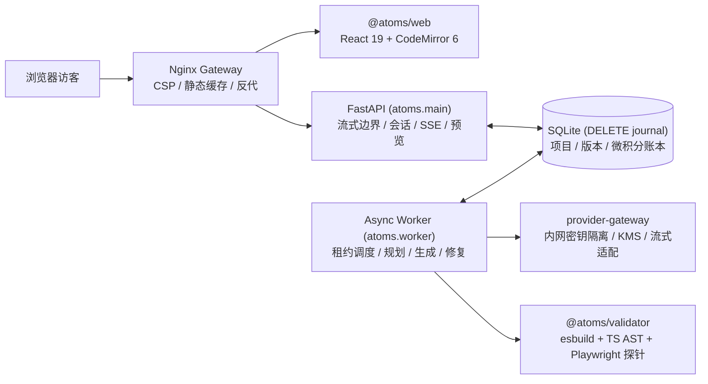

# Atoms Studio

把自然语言需求变成真实可交互网页、网页幻灯片、2D/3D 浏览器游戏与原生视频，并在同一工作台中持续迭代、持久化业务状态、恢复历史版本、独立分享和导出完整工程源码。

本地优先开发，后续通过同一组 Docker 镜像部署到单台云服务器。需求与演进基线见 [需求规格 v0.5](docs/requirements.md) 和 [技术手册](docs/technical-plan.md)。

## 架构概览与工程设计

核心架构决策记录（ADR）：
- [ADR-0001：多层静态契约校验与隔离无头浏览器真实验收闭环](docs/adr/0001-sandbox-and-browser-verification.md)
- [ADR-0002：微积分预授权账本、取消原子边界与流式断流用量保全](docs/adr/0002-micro-credit-ledger-and-stream-settlement.md)
- [ADR-0003：多级反向代理真实访客 IP 剥离与流式边界防护](docs/adr/0003-trusted-proxy-ip-and-boundary-guardrails.md)
- [ADR-0004：基于状态不变量与可手算样例的游戏规则结构化规划](docs/adr/0004-structured-game-mechanics-planning.md)

## 本地启动

需要 Docker Desktop（Linux 容器）。当前 Windows 环境也可使用已安装的 Python、Node.js 24 和 uv 运行检查。

在项目根目录执行：

~~~powershell
python scripts/init_env.py
.\scripts\dev.ps1
~~~

打开 [http://localhost:8080](http://localhost:8080)。首次构建需要下载 Chromium。数据保存在 Docker 的 atoms_app_data 卷中，停止或重建容器会保留项目。

填入 .env.local 的模型配置：

~~~dotenv
LLM_BASE_URL=https://api.deepseek.com
LLM_MODEL=deepseek-flash
LLM_API_KEY=在本机填写
LLM_RESPONSE_MODE=json_object
LLM_TOKEN_LIMIT_PARAM=max_tokens
LLM_PROVIDER_MAX_OUTPUT_TOKENS=393216
LLM_THINKING_MODE=disabled
~~~

deepseek-flash 是官方 API 名称，目前对应 DeepSeek-V4.1-Flash-1017。[官方入口](https://api-docs.deepseek.com/)、[JSON 输出](https://api-docs.deepseek.com/guides/json_mode/)、[思考模式](https://api-docs.deepseek.com/guides/thinking_mode/)。

只修改供应商配置时，重新创建网关即可：

~~~powershell
docker compose --env-file .env.local up -d --no-deps --force-recreate provider-gateway
~~~

供应商密钥只注入内网 `provider-gateway`。Worker 使用单独的服务令牌请求统一文本和视频接口，API 通过 Worker 心跳读取能力。`.env.local` 已被 Git 和 Docker 构建上下文排除。缺少配置时工作台可以打开和读取项目，生成入口会明确提示待配置。换 OpenAI 兼容文本模型时修改网关配置并重新创建网关即可。

输出空间依据供应商 /models 的原生能力和用户可用积分动态分配。LLM_PROVIDER_MAX_OUTPUT_TOKENS 是能力元数据不可用时的供应商能力回退，不是旧的 8192 token 小上限。DeepSeek 不传 max_tokens 时非思考模式仍默认 8K，因此请求显式使用动态预算。

## 匿名用户与积分

首次打开由服务端生成随机用户 ID，浏览器 Cookie 维持身份，无需注册或登录。新用户免费获得 50 积分（相当于 5 元使用额度）。

- 输入每百万 token 20 积分，输出每百万 token 80 积分。
- 按供应商返回的真实用量计算费用。每次模型或视频调用单独向上取整到整分，零用量扣 0 分。
- 每次调用先预授权，结束后按真实用量结算并释放差额。自动修复单独计费；有实际用量的失败或截断也计费。
- 缺少 usage 的网络中断/超时或 Worker 硬退出，积分冻结并标记待核对；不会伪造消费数字。维护核对见部署手册。
- 侧栏或手机页头可查看余额、随机用户 ID、费率和流水。余额耗尽后既有项目、预览与导出继续可用。
- 移除旧生成次数、项目数和版本数配额；同项目单个活动任务、沙箱及较大的资源保护继续维持执行一致性。

迁移 0002 曾为当时的旧访客补发一次 500 积分。既有钱包沿用账本余额，升级前的预授权按原规则结算。清除 Cookie 或换浏览器会成为新匿名用户。当前没有充值、提现或支付功能。

## 已实现

- 匿名会话与访客项目隔离；创建项目、列表、重新打开和草稿。
- 匿名积分钱包、首次赠送、精确 token 账本、预授权、余额校验与异常用量核对。
- 真实模型调用适配器；持久化任务、SSE 阶段回放、刷新后继续观察。
- 按项目类型加载网站、幻灯片、游戏的生成 Skill。视频使用 Vidu Q3 Pro 文生视频 / 图生视频服务，默认 540p，文字即可生成，也可上传首帧，支持声音、时长、原生播放、MP4 下载与历史版本，按供应商实际费用折算平台积分。详见 [视频接入手册](docs/vidu-video.md)。
- React 网站和游戏由主 Agent 规划、专业实现 Agent 生成，并经编译、沙箱契约与隔离浏览器启动检查；失败反馈在同一个任务内触发最多 10 轮自动修复（同类根因最多 2 轮）。原生视频生成成功后直接保存，按供应商实际用量结算。
- 幻灯片模板支持翻页预览、编辑预填需求和按所选版式创建项目。
- 新网站和游戏交付 React 与 TypeScript 多文件源码；历史 HTML / CSS / JavaScript 产物仍可预览。
- 新闻与专题、个人作品集和产品发布页有内置 React 参考模板。模型会根据需求改写页面主题、视觉与内容，未匹配的需求进入自由生成。生成的版本支持继续修改和导出。
- 外汇项目在生成时可引入欧洲中央银行参考汇率快照，数据附来源与发布日期。数据源不可用时使用标注过期的缓存，首次拉取失败则提供空数据状态。
- 财经资讯需求可引入国家统计局和美联储的公开发布快照，展示标题、发布日期与官方地址。
- 交互预览、桌面/手机宽度切换、可搜索的只读源码树与语法高亮。React 源码 ZIP 含可直接托管的静态构建产物和按实际引用依赖生成的 Vite 工程（内置预装 `react`、`react-dom`、`lucide-react`、`three`）。
- 精选作品展厅支持零积分切换「交互预览 / 只读源码 / 构建回放」，透明展示 `BuildStory` 规划、校验诊断与自动修复轨迹。
- 工作区内置默认折叠的「工程透视（Agent & Validator Inspector）」抽屉，实时查看 `TaskPlan` 拆解、游戏 `GameMechanics` 规则样例、沙箱/浏览器验收摘要、历史修复定位与逐笔微积分账单。
- 多文件 React 迭代支持确定性增量补丁协议（`mode: "patch"` + `deleted_files`），仅修改受影响模块并自动原样合并既有模块，遇到引用异常自动回退全量输出。
- 公网部署安全护栏：按 `Asia/Shanghai` 自然日自动重置的全站公共预算熔断器（熔断期间精选展厅、历史查看、本地改码预览与导出保持完整可用）及 SQLite 哈希持久化的访客体验口令（专属额度、豁免公共熔断与视频生成解锁）。
- 独立离线质量基准套件 `evals/`（内置 22 条跨 6 大类代表用例），默认使用隔离临时库运行并输出脱敏 JSON 与回归对比 Markdown 报告。
- 按项目保存生成应用业务数据；CAS 冲突检查及保存状态反馈。
- 不可变版本、历史只读预览、恢复后继续分支、源码 ZIP 导出。
- Worker 租约、过期任务回收、失败保留稳定版本。失败构建保留候选内容，继续修复时先复验已有候选。网站审核和必要的修改按实际模型用量结算。
- 本地 Compose、生产静态镜像、HTTPS Nginx 配置、维护模式与 SQLite 在线备份/离线恢复。

生成的网站以静态文件交付，工作台为预览提供按项目隔离的数据保存。React 运行时由平台统一打包，生成代码的网络和依赖权限由预览沙箱管理。真实数据由 Worker 接入受支持的数据源，生成内容使用随版本保存的数据快照。支持范围可在工作台内查看。

## 服务与模块分层

后端 `apps/api/atoms` 按单向无环依赖域（`core / skills` → `billing / gateway / domains` → `runtime` → 进程入口）分层，并由架构单测 `tests/test_architecture.py` 持续守护边界：

| 位置 | 职责 |
| --- | --- |
| `apps/web` | React 19、TypeScript、CodeMirror 6 工作台与 DOM 组件单测 |
| `apps/api/atoms/main.py`、`worker.py`、`provider_gateway.py`、`ops.py` | API 服务、异步任务 Worker、内网供应商网关与维护对账 CLI 四个进程入口 |
| `apps/api/atoms/core/` | 配置校验、SQLite 事务封装、请求 Schema、可信代理 IP 剥离与会话安全 |
| `apps/api/atoms/billing/` | 百万分之一积分整数账本、预授权冻结/结算/释放与媒体计费 |
| `apps/api/atoms/gateway/` | OpenAI 兼容流式/JSON 协议适配、Vidu 视频适配、KMS 密钥与校验器客户端 |
| `apps/api/atoms/domains/` | 产物解析、网站模板、幻灯片渲染、2D/3D 游戏规则与外部汇率/资讯快照 |
| `apps/api/atoms/runtime/` | 主 Agent 规划编排、提示词组装、构建诊断自愈、沙箱预览打包与独立发布 |
| `apps/api/atoms/skills/` | 按项目类型与游戏品类加载的专业生成指导 Skill |
| `apps/validator` | `esbuild` React 打包、TypeScript AST 沙箱契约检查、parse5/PostCSS 与 Playwright 验收 |
| `shared` | 跨服务 JSON Schema、运行时预装依赖清单、可信预览模板与存储 SDK |
| `evals` | 22 条版本化离线评测基准集（`cases.json`）与回归对比 CLI（`run_eval.py`） |
| `deploy`、`scripts` | Nginx 安全头与反代配置、生产编排文件、在线备份恢复与隔离验收脚本 |

生成代码只在 opaque-origin iframe 或独立非 root Chromium 容器执行。预览由 HTTP CSP、MessagePort、单版本短期凭证和项目绑定的存储接口共同约束。校验器不挂载数据库，浏览器不继承服务密钥。机制与残余边界见 [实现决策](docs/decisions.md)。

SQLite 使用 DELETE journal、短事务和单 Worker；当前实现面向单台机器，不提供水平扩容。成功交付在同一事务中写入产物、版本、项目指针、完成消息和事件。

Worker 默认一次运行 1 个任务，网站、游戏、幻灯片和视频共用名额。满额后按提交顺序等待，同一项目保留一个活动任务。可在 `.env.local` 或生产环境文件中调整 `RUN_CONCURRENCY`（1–8），重建 Worker 后生效。浏览器校验使用独立的单槽位。

生成 Skill 的接入、游戏渲染选择和启动检查见[生成 Skill 实现](docs/generation-skills.md)。

## 开发与检查

~~~powershell
npm ci
uv sync --project apps/api
uv run --directory apps/api ruff check atoms tests
uv run --directory apps/api ruff format --check atoms tests
uv run --directory apps/api pytest -q
npm run check
npm run test
npm run build
~~~

完整 UI 验收使用独立的 atoms-e2e Compose 项目、8082 端口和数据库卷：

~~~powershell
.\scripts\test-e2e.ps1
~~~

测试产物提供器只允许 APP_ENV=test 且 TEST_FIXTURE=true；生产和日常开发不会用它替代模型生成。测试环境明确显示 test-fixture-only 模型。它验证编排、隔离和持久化机制，不代表真实模型生成验收。

测试服务运行时，还可以执行：

~~~powershell
uv run --project apps/api python scripts/check-restart.py
uv run --project apps/api python scripts/check-recovery.py
uv run --project apps/api python scripts/check-backup.py
Get-Content scripts/security-spike.mjs -Raw | docker compose --env-file .env.test -p atoms-e2e exec -T validator node --input-type=module
~~~

前三项检查使用已完成 UI 测试保存在 test-results 内的临时会话，或自行创建测试会话；不读取日常开发数据。check-recovery 会强制结束命名的测试 Worker。check-backup 会临时停止测试 API/Worker 并恢复测试数据库。可通过 .\scripts\test-e2e.ps1 -KeepRunning 保留测试服务供这些检查使用。

真实服务配置后，运行以下协议和生成冒烟检查；它会调用已配置的模型并消耗额度：

~~~powershell
uv run --project apps/api python scripts/model-smoke.py
~~~

实际结果、未完成的外部验收和范围追踪见 [验收记录](docs/verification.md)。后续阿里云部署步骤见 [部署手册](docs/deployment.md)。

界面记录：[首页](docs/screenshots/homepage.png)、[积分钱包](docs/screenshots/wallet-desktop.png)、[桌面工作台](docs/screenshots/workspace-desktop.png)、[手机预览](docs/screenshots/workspace-mobile.png)。工作台截图中的计数器和钱包用量为测试专用数据，用于记录机制验收；真实 DeepSeek 用量另记在验收记录中。

## 常用操作

~~~powershell
.\scripts\dev.ps1 status
.\scripts\dev.ps1 logs
.\scripts\dev.ps1 down
docker compose --env-file .env.local exec -T api python -m atoms.ops maintenance on
docker compose --env-file .env.local exec -T api python -m atoms.ops maintenance off
docker compose --env-file .env.local exec -T api python -m atoms.ops passcode-create --label recruiter-demo --credits 200 --allow-video
docker compose --env-file .env.local exec -T api python -m atoms.ops passcode-list
uv run --project apps/api python evals/run_eval.py run --fixture --label baseline --output test-results/eval-base.json
uv run --project apps/api python evals/run_eval.py compare test-results/eval-base.json test-results/eval-base.json
~~~

不要使用 down -v 清理有价值的数据卷。备份应通过 SQLite backup API，不能直接复制正在使用的数据库文件。备份和恢复命令见部署手册；含视频的备份必须同时保留数据库旁的同名 .media 目录。
